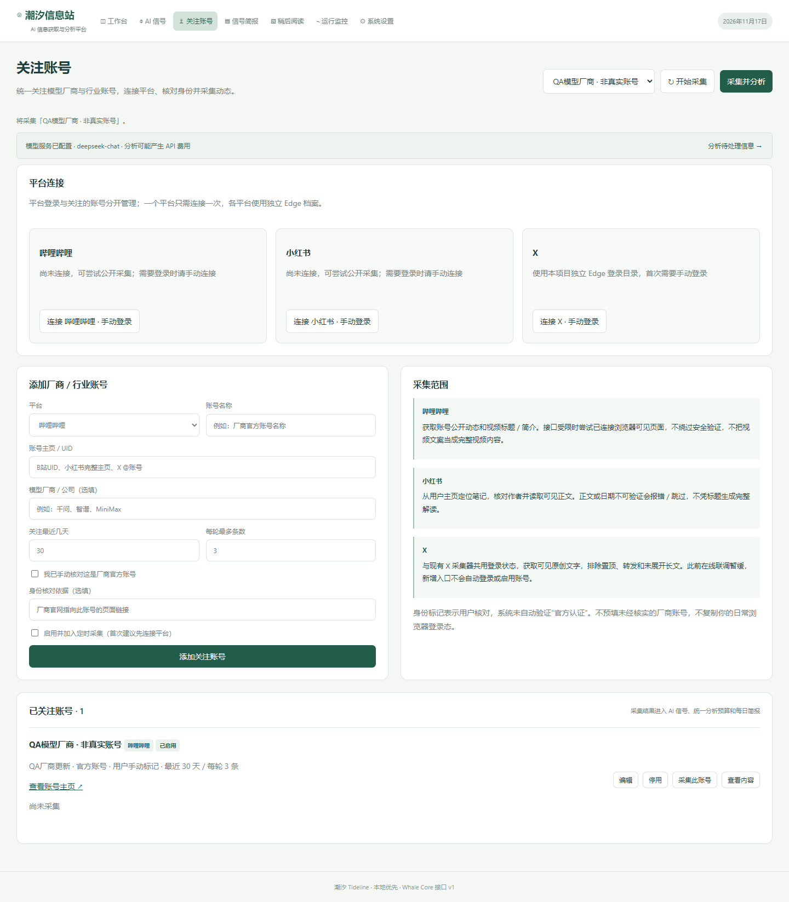

# 潮汐 Tideline

本地优先的 AI 信息采集、分析和阅读工作台。支持新闻订阅、厂商账号管理、每日简报，以及 Whale Core / AstrBot 接入。

**模型分析不是免费服务。** 默认示例使用 DeepSeek 官方 API，按输入/输出 tokens 计费；免费网页聊天不等于免费 API。新安装默认关闭定时任务，启用前请设置每日调用上限。[模型与费用](docs/models-and-cost.md)

## 快速启动

需要 Node.js 24+。Windows 社交平台连接使用已安装的 Microsoft Edge；其他系统需有 Chrome。

```sh
git clone https://github.com/XneoZero/tideline.git
cd tideline
npm ci
cp .env.example .env
# 编辑 .env，按需要填写模型配置和独立接口令牌
npm start
```

Windows 可用 `Copy-Item .env.example .env`。打开 [本机工作台](http://127.0.0.1:4317)。Windows 后台运行：`powershell -ExecutionPolicy Bypass -File scripts/start.ps1`；停止：同目录 `scripts/stop.ps1`。未安装开机自启。

## 功能

- RSS / Atom / JSON / 公开 Feed；内置 OpenAI、Anthropic、量子位入口。
- Bilibili、小红书、X统一“关注账号”：主页录入、平台连接、厂商标签、身份声明、启停、单账号采集与内容筛选。
- 原文与中文模型解读分开，保留来源、时间、材料范围和过滤原因；URL去重、搜索、已读与收藏。
- 持久定时队列、失败退避、重启恢复、每日调用限额、Markdown简报导出。
- Whale Core接口，以及独立鉴权、只读的AstrBot接口和Python插件示例。



## 使用顺序

1. 在“系统设置”添加内置新闻来源或订阅。
2. 在“关注账号”填写真实主页，按需手动连接平台。新账号默认停用，确认后再启用。
3. 采集后查看原文；配置模型后可执行“采集并分析”，每轮界面最多分析3条。
4. 在“自动运行”设置周期、条数与日上限，主动启用调度。服务运行时才执行。
5. 在“信号简报”按日期生成、读取和导出；历史文章按原文发布日期归档。

## 当前范围

这是可运行的早期版本。新闻HTTP采集与模型链路已有实测；社交平台适配器和登录入口已接入，但受账号登录、页面结构、网络和平台访问限制影响，不保证全部账号可采集。B站公开接口可能返回412；小红书与X需要逐账号登录验收。不会绕过登录或安全验证。

B站目前读取动态与视频文案，小红书读取可见笔记文字，X读取可见主帖文字。没有视频转写、图片OCR、完整评论或thread解析。“官方身份”是用户核对标记，不是系统自动认证。

默认仅监听127.0.0.1，控制台为本机单用户设计，没有公网多用户鉴权；不要直接暴露管理端口。数据库、登录档案、密钥和运行记录均不进入源码仓库。

## 测试

```sh
npm test
npm run test:browser
# 插件客户端测试（不需要完整AstrBot）
python -m pip install -r integrations/astrbot_plugin_tideline/requirements.txt
python -m unittest discover -s test -p "test_astrbot_client.py"
```

Node测试使用独立内存库或临时库；浏览器流程主要使用隔离夹具和模拟模型。测试不会发送QQ消息或调用收费模型。

## 接入与开发

[架构](docs/architecture.md) · [账号采集](docs/accounts.md) · [AstrBot](docs/astrbot.md) · [Whale Core](docs/whale-integration.md) · [模型费用](docs/models-and-cost.md)

AstrBot插件目录：`integrations/astrbot_plugin_tideline/`。整个仓库不是可直接从AstrBot“仓库安装”的插件根目录，请按接入文档复制该子目录或安装插件ZIP。

MIT License，见 [LICENSE](LICENSE)。
